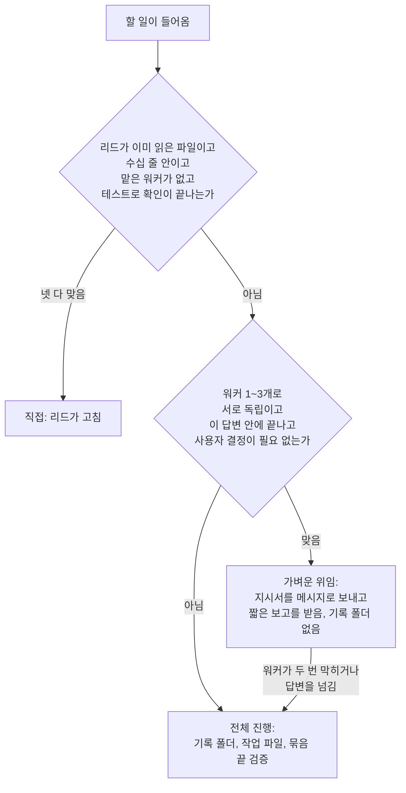
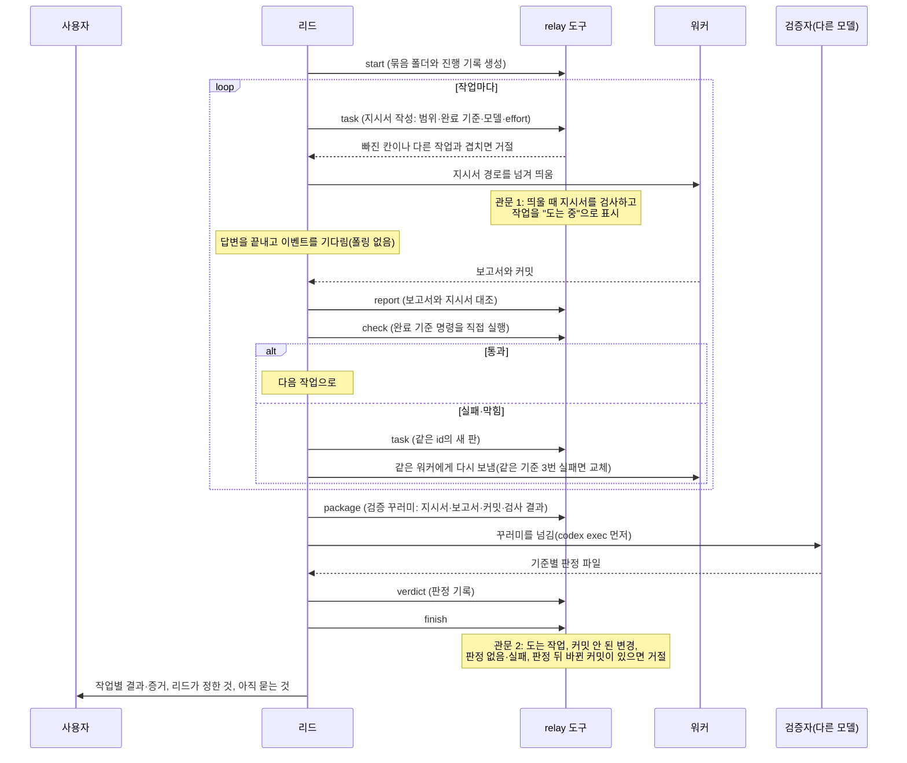
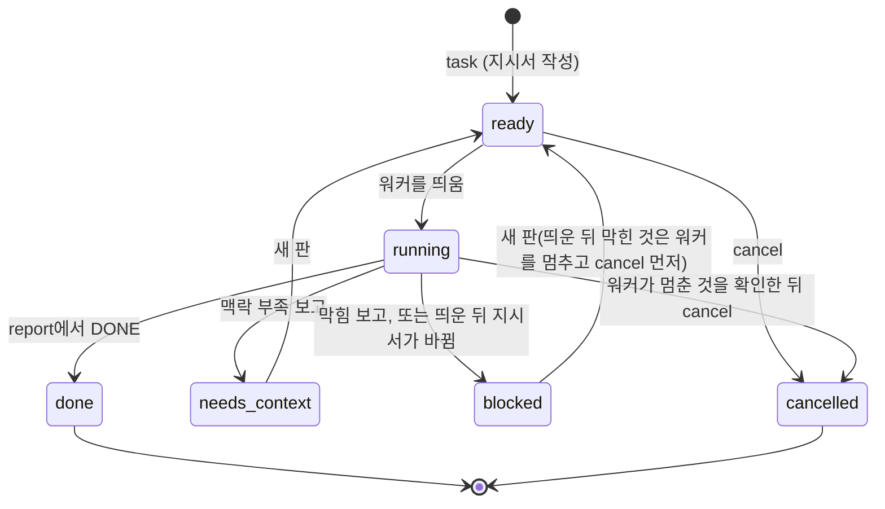

# relay 동작 흐름

relay는 리드(지금 대화하는 세션)가 일을 나눠 워커에게 맡기고, 돌아온 결과를 확인하고, 다른 모델의 검증을 거쳐 끝내는 방식이다. 판단은 리드가 스킬(`skills/relay/SKILL.md`)을 읽고 하고, 답이 하나로 정해지는 일(지시서 쓰기, 보고서 대조, 완료 명령 실행, 검증 꾸러미, 끝내기 거절)은 도구 `mcp__hubblerc__relay`가 한다. 설계 근거와 세부는 `docs/spec.md`의 F13에 있다.

## 1. 먼저 길을 고른다

작은 길이 먼저다. 막히면 위로 올린다.

## 2. 전체 진행의 한 바퀴

## 3. 작업 하나의 상태

끝난(done) 작업은 취소할 수 없다. 그 커밋이 검증 꾸러미에 들어가기 때문이다.

## 4. 지키는 것

- **사용자에게 묻는 것은 정해져 있다.** push, 배포, 외부 전송, 평소를 넘는 비용, 완료 기준 변경, 되돌리기 어려운 일만 묻는다. 나머지는 리드가 정하고 "결정·이유·틀렸을 때 비용"을 결정 표에 적어 끝에 모두 보고한다.
- **워커의 "테스트 통과"는 증거가 아니다.** 완료 기준 명령은 도구가 직접 돌린다.
- **보낸 지시서는 고치지 않는다.** 바꿀 것이 있으면 같은 id로 새 판을 만든다.
- **워커끼리 문서를 공유하지 않는다.** 한 워커가 알아낸 것은 리드가 보고서에서 골라 다음 지시서의 "먼저 읽을 것"에 넣는다.
- **기다림은 이벤트로만.** Orca의 깨움, 서브에이전트 완료 알림, 백그라운드 명령 종료를 기다린다.
- **두 관문은 훅이다.** 띄우기 전 지시서 검사와 끝내기 전 검증 대조는 건너뛸 수 없다.

## 5. 어디에 무엇이 있나

| 무엇 | 어디 |
|---|---|
| 리드의 규칙 | `plugins/hubblerc/skills/relay/SKILL.md` |
| 실행 환경별 안내(Orca, 서브에이전트, codex exec) | `plugins/hubblerc/skills/relay/references/` |
| 도구(지시서·보고·검사·꾸러미·판정·끝내기) | `plugins/hubblerc/hooks/relay/relay.ts` |
| 관문 1·2 | `plugins/hubblerc/hooks/relay/gate.ts` |
| 사이드바 상자·`/relay-status` | `plugins/hubblerc/hooks/relay/relay-view.tsx`, `relay-status.ts` |
| 묶음의 기록(진행 기록, 지시서, 보고서, 판정) | `.relay/runs/<날짜>-<이름>/` (git에 넣지 않음) |
